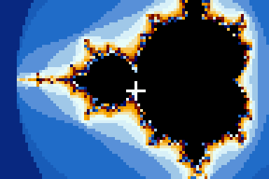
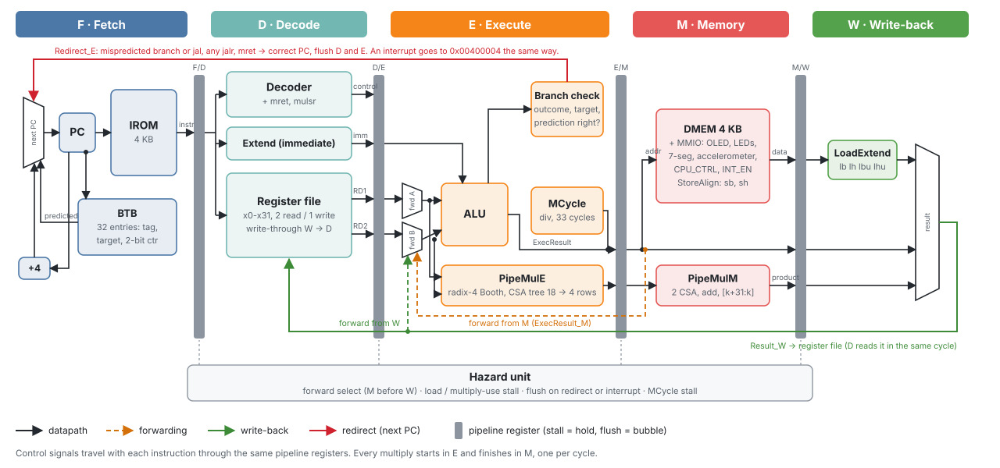
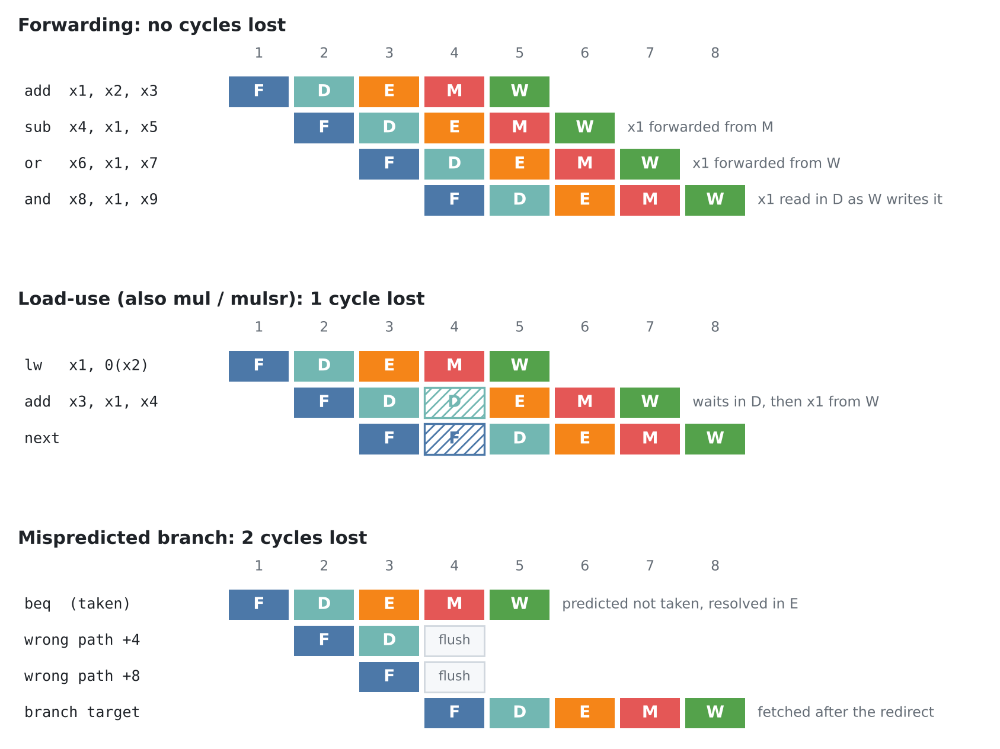
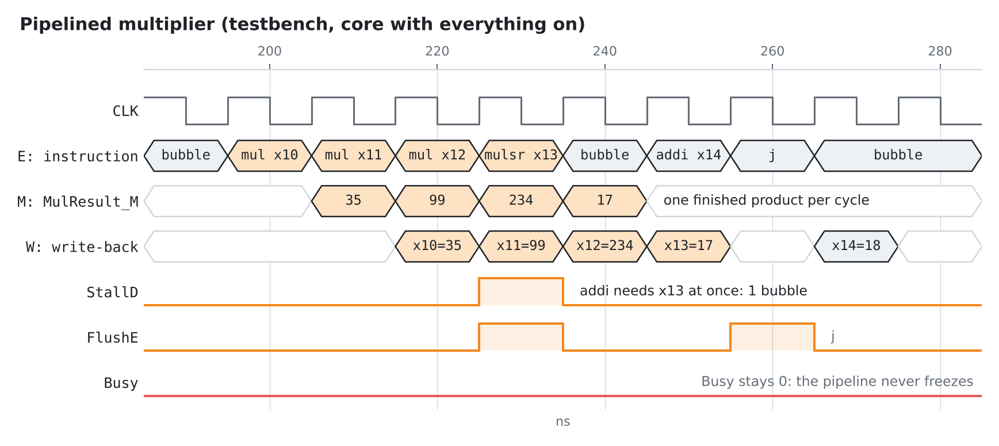
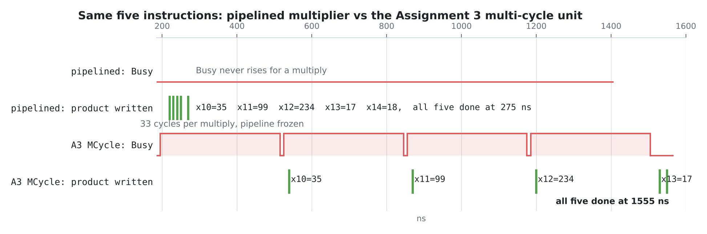
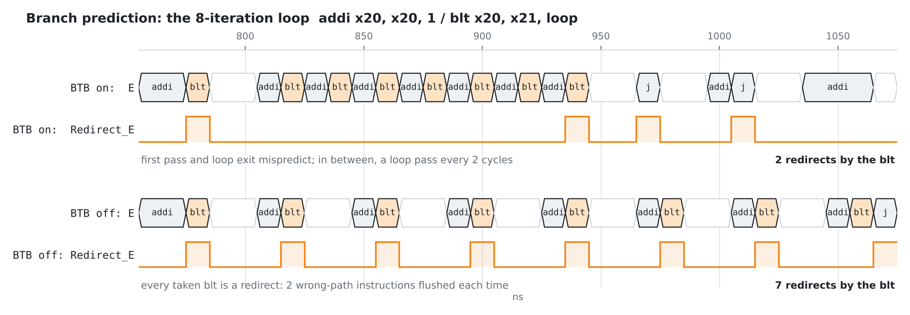
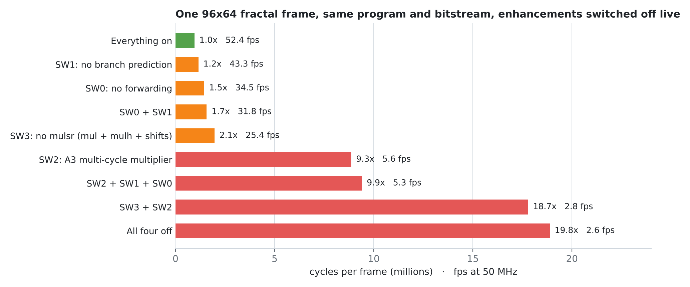

# CG3207 Computer Architecture: a RISC-V CPU, from one cycle to five stages

<p align="center">
  
  
</p>
<p align="center"><sub>
Our pipelined RISC-V CPU rendering fractals in real time on a 96×64 OLED. These frames come from the demo
program in the bitstream, rendered on the reference model and pixel-identical to the RTL simulation.
</sub></p>

Lab work for **CG3207 Computer Architecture** at the National University of Singapore (AY2026/27 Semester 1),
on a Digilent **Nexys 4 DDR** (Artix-7 `xc7a100tcsg324-1`) with Vivado 2023.2.
Over four assignments, a RISC-V processor goes from a single-cycle RV32I core to a 5-stage pipelined RV32IM
with a pipelined Booth multiplier, a custom fixed-point instruction, branch prediction and interrupts.

## Highlights

- **5-stage pipeline at 50 MHz**, all timing constraints met (WNS +2.892 ns). The demo runs at **CPI 1.015**.
- **Pipelined multiplier**: radix-4 Booth and a carry-save tree split across E and M. One multiply starts
  every cycle, instead of the 33-cycle stall of the Assignment 3 unit.
- **Custom instruction `mulsr rd, rs1, rs2, k`** = (rs1 × rs2) >> k: a fixed-point multiply in one
  instruction instead of five. The fractal frame is 2.1× faster with it.
- **Live A/B switches**: forwarding, branch prediction and the fast multiplier can each be turned off from
  the DIP switches while the program runs. All four off is **19.8× slower** on the same bitstream.
- **Verified against a reference model**: 1000 random programs in every switch mode, 60 interrupted at
  random, 19 of 20 planted bugs caught. A whole-chip simulation with a model of the OLED panel found
  why the screen stayed blank after programming.

## The four assignments

| | Assignment | What we built | Folder |
|---|---|---|---|
| 1 | HDL, FPGA and assembly | Show a RISC-V program's memory on the LEDs and 7-segment display, clock-enable design, testbench | [`as1`](lab_assignments/as1) |
| 2 | Basic CPU design | Single-cycle RV32I: datapath, decoder, ALU with shifts and branch flags, a self-checking demo program | [`as2`](lab_assignments/as2) |
| 3 | ALU design | RV32M through a multi-cycle unit: restoring division, radix-2 Booth (65 → 33 cycles), an interactive visualisation | [`as3`](lab_assignments/as3) |
| 4 | Advanced CPU design | 5-stage pipeline, hazard unit, BTB, pipelined multiplier, `mulsr`, byte/half-word access, interrupts, MMCM clocking, a fractal explorer in C | [`as4`](lab_assignments/as4) |

Each folder is its own Vivado project (`*.xpr`) with a README covering the design, how it was tested and
how to run it. What was handed in for each assignment is in [`submissions`](submissions).

## The pipelined CPU (Assignment 4)



Five stages with a pipeline register between each pair. Each register can **stall** (hold) or **flush**
(insert a bubble), and the control signals travel with their instruction. The hazard unit decides:

| Hazard | Handled by | Cost |
|---|---|---|
| ALU result needed by the next instructions | forward from M or W into E | 0 |
| Register written in W, read in D | register-file write-through | 0 |
| Load or multiply, then an immediate user | stall F and D, bubble into E | 1 cycle |
| Mispredicted branch or jal, any jalr, mret | flush D and E | 2 cycles |
| Divide in E (MCycle busy) | stall F, D, E; bubble into M | about 33 cycles |



### Waveforms from the testbench

The multiplier: three independent `mul`s and a `mulsr` finish on consecutive cycles. The `addi` that needs
the `mulsr` result straight away waits one cycle, the same rule as a load.




Branch prediction: with the BTB, the loop branch mispredicts only on the first pass and at the exit.



### Performance

The demo renders the Mandelbrot or Julia set in Q7.25 fixed point, three multiplies per iteration.
The same program measures its own cycles per frame and shows them on the 7-segment display, so flipping a
switch shows what each enhancement is worth:



Tilt the board to fly around (accelerometer), BTNR / BTNL to zoom, and BTNC to switch to the Julia set of
the point under the crosshair (a push-button interrupt). Full controls are in the
[Assignment 4 README](lab_assignments/as4#the-demo-program-fractal-explorer-swdemofractalc).
<!-- Board video: drag an .mp4 into this README in GitHub's web editor and it becomes an embedded player. -->

## Repository layout

```
lab_assignments/
  as1/  as2/  as3/  as4/      one Vivado project per assignment (sources in <as>.srcs/sources_1/imports/as2)
  as4/sw/                     demo program in C, start-up code, linker script, build.py
  as4/sim/                    reference ISS, random-program fuzzer, regression, whole-chip simulation
  as4/sim/enhancement_tests/  testbench package with ready-made Vivado waveform views
submissions/                  what was handed in for each assignment
docs/media/                   diagrams, charts, waveforms and frame renders used in the READMEs
docs/tools/                   the scripts that draw them
```

## Running it

**On the board.** Open `lab_assignments/as4/as4.xpr` in Vivado 2023.2, generate the bitstream and program
the board, with the Pmod OLED in header JB. The display starts by itself.

**Simulation without Vivado** (Linux or WSL):

```sh
sudo apt install iverilog gcc-riscv64-unknown-elf
cd lab_assignments/as4
python3 sim/run_tests.py                         # random programs vs the reference model, every mode
sh sim/enhancement_tests/run_icarus.sh           # the enhancement testbenches, prints PASS
cd sw && python3 build.py demo/fractal.c         # rebuild the demo's AA_IROM.mem / AA_DMEM.mem
```

**The figures** in this README are drawn by [`docs/tools`](docs/tools):
`render_frames.py` (fractal frames and GIFs from the demo program), `make_figures.py` (charts, and
waveforms from a VCD of the enhancement testbench) and `datapath_svg.py` (the block diagram).

## Credits

Course templates (Wrapper, TOP, peripherals, OLED controller, Assignment 1 modules) are from the NUS
CG3207 teaching team. Hin Lok designed the radix-2 Booth multiplier and its visualisation in Assignment 3;
Qi Ye wrote the division dataflow walkthrough. As the lab manual asks, AI assistance (Claude, by Anthropic)
is declared where it was used: in the assignment READMEs, the file headers and the Assignment 3 prompt
history.
