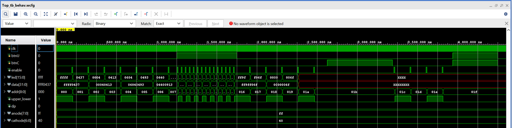

# Assignment 1: HDL, FPGA and assembly familiarisation

Individual exercise (Week 5 demo). The first contact with the Nexys 4 DDR board, Vivado and RISC-V assembly.

## What it does

A small Verilog design reads two memories and shows their contents on the board:

- **IROM** holds a short RISC-V program (13 instructions, `IROM.mem`). **DMEM** holds its data (`DMEM.mem`).
  Both were assembled in RARS and dumped as hex.
- Every tick, the next word is shown. The 7-segment display shows all 32 bits. The 16 LEDs show the upper
  half, then the lower half, so each word takes two ticks. The IROM words come first, then DMEM.
- **BTNU** switches between 1 Hz and 4 Hz. **BTNC** pauses.

| Module | Role |
|---|---|
| `Top_Nexys_Asst1.v` | Top level: wires the three blocks to the board pins |
| `Clock_Enable.v` | A one-cycle `enable` pulse at 1 Hz or 4 Hz. The whole design stays on the 100 MHz clock, and `enable` is not used as a clock |
| `Get_MEM.v` | Loads `IROM.mem` / `DMEM.mem` with `$readmemh`. A 9-bit address steps on `enable`: bit 8 picks IROM or DMEM, bits 7:1 the word, bit 0 the LED half |
| `Seven_Seg_Nexys.v` | Multiplexes the eight 7-segment digits |
| `Top_tb.v` | Testbench with the thresholds shrunk to 15 / 3 cycles, so the 1 Hz / 4 Hz behaviour shows within a few microseconds |

## Simulation

`enable` pulses slowly at first. With `btnU` held, it pulses 4× as often. While `btnC` is held it stops.
`addr` counts up, and `led` alternates between the upper and lower halves of `data`
(`ffff`, `0437` = `0xffff0437`, the first instruction).

## Files

The Vivado project (`a1.xpr`) and testbench are in this folder. The sources, bitstream and constraints are
the submitted versions in
[`submissions/as1_submission_a0308961x`](../../submissions/as1_submission_a0308961x).
