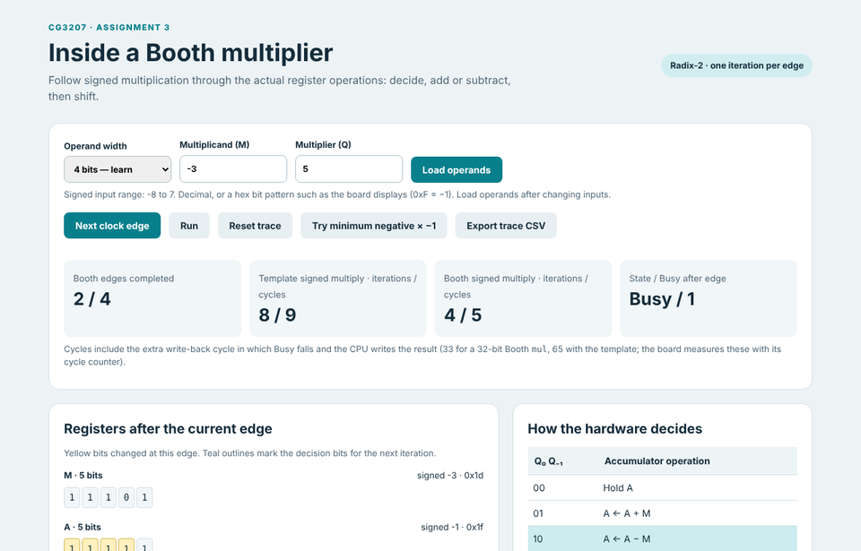
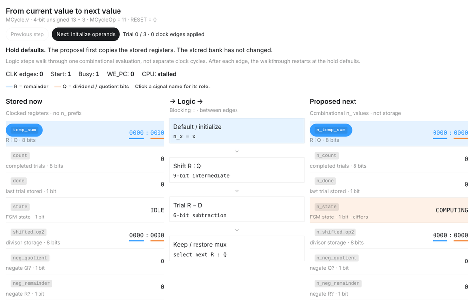

# Assignment 3: multiplication and division (Week 9 demo)

Multiply and divide (RV32M) for the single-cycle CPU, with a multi-cycle `MCycle` unit, a radix-2 Booth
multiplier as the enhancement, and an interactive visualisation of it.

This is its own Vivado project (`as3.xpr`), started as a copy of the Assignment 2 project in
`../as2`, which stays as it was demoed. Open `as3.xpr` in Vivado for all Assignment 3 work.

## Results

| Task | What was done | How it was verified |
|---|---|---|
| 1 Division | Signed + unsigned restoring division in MCycle | `test_MCycle`: exhaustive at width 4 and 6, corner cases + random at width 32 — 76 083 checks pass. MCycle synthesises as top with no warnings from MCycle.v |
| 2 CPU | mul, mulh, mulhu, div, divu, rem, remu; stall on Busy; demo program | `test_Wrapper`: 229 checks pass; `cpu_check.py`: 6 703 RV32I checks pass; on the board the self-check showed LED = 0xFF (with the earlier multiplier) |
| 3 Enhancement | Radix-2 Booth for signed multiplication (Hin Lok): 65 → **33 cycles** for a signed `mul` | `test_MCycle` (all 76 083 checks, incl. exhaustive 4/6-bit); gate-level simulation of both versions; Vivado numbers on the slides |
| 4 Visualisation | `booth_visualisation.html` (Hin Lok), plus a datapath diagram, cycle counts and hex input | A/Q/Q₋₁ after every edge identical to the Verilog simulation |

<p align="center">
  
  
  <br><sub>Left: <code>booth_visualisation.html</code>, stepping −3 × 5 one clock edge at a time.
  Right: <code>docs/CG3207_Task1_Division_Dataflow.html</code>, the restoring division signal by signal.
  Both are single HTML files; open them in a browser.</sub>
</p>

## Where things live

| What | File |
|---|---|
| MCycle unit (Tasks 1 and 3) | `as3.srcs/sources_1/imports/as2/MCycle.v` |
| MCycle testbench, self-checking (+ `test_MCycle_postsynth` for Task 3) | `as3.srcs/sources_1/imports/as2/test_MCycle.v` |
| CPU changes (Task 2) | `RV.v`, `Decoder.v`, `Wrapper.v` (memory sizes only) in the same folder |
| CPU testbench, self-checking | `test_Wrapper.v` in the same folder |
| Demo program | `test.asm` (this folder) → `AA_IROM.mem` / `AA_DMEM.mem` in `sources_1` and `sim_1` |
| RV32I regression self-test | `cpu_check.py` (this folder): `python cpu_check.py --root .` |
| Task 4 visualisation | `booth_visualisation.html` (open in any browser) |
| Task 4 prompt history | `prompt_history.md` |
| Task 3 slides | `Task3_Booth_Slides.pdf` |
| Study notes & demo guide (demo script, slides explained, all tasks, Booth radix-2 and radix-4, Q&A, cheat sheet) | `docs/CG3207_Asst3_Study_Notes.pdf` (source: `.md` next to it) |
| Division walkthrough, signal by signal (Qi Ye) | `docs/CG3207_Task1_Division_Dataflow.html` |

## Task 1 — Division

Restoring division on magnitudes, one quotient bit per cycle (`width` cycles, 33 for 32-bit including
the write-back cycle):

1. **Start:** `{R, Q} = {0, |dividend|}`, `D = |divisor|`. Magnitudes are only taken for signed
   division. The signs the results need are remembered.
2. **Each cycle:** shift `{R, Q}` left by 1. If `R ≥ D`, set `R = R − D` and the new quotient bit to 1;
   otherwise restore and set it to 0. The bit shifted out of R is kept, because R can reach 2D−1 after
   the shift.
3. **End:** negate the quotient if the operand signs differ. The remainder takes the dividend's sign.

The results follow RISC-V: the quotient rounds towards zero, `−2³¹ / −1 = −2³¹` with remainder 0, and
`x / 0` gives a quotient of all ones and a remainder of `x`. The manual says the divisor is never zero,
but this still matches RISC-V and RARS.

## Task 2 — CPU integration

- **Decoder:** opcode `0110011` with funct7 `0000001` raises `MStart` and selects `MCycleOp` and which
  MCycle result to write (`MResultSel`). `MCycleSel` makes the CPU write the MCycle result instead of
  the ALU result.

  | Instr | funct3 | MCycleOp | Result |
  |---|---|---|---|
  | mul | 000 | 00 | Result1 (low word) |
  | mulh | 001 | 00 | Result2 (high word) |
  | mulhu | 011 | 01 | Result2 |
  | div | 100 | 10 | Result1 (quotient) |
  | divu | 101 | 11 | Result1 |
  | rem | 110 | 10 | Result2 (remainder) |
  | remu | 111 | 11 | Result2 |

  `mulhsu` (funct3 010) is not supported and decodes as a NOP.
- **RV.v:** MCycle (width 32) takes RD1/RD2. `WE_PC = ~Busy` freezes the PC, and with it the
  instruction, while MCycle works. The register write is held off (`WE = RegWrite & ~Busy`) and
  happens in the cycle where Busy falls. A multiplexer chooses between the ALU and MCycle results.
- **Wrapper.v:** IROM and DMEM enlarged to 256 words (`*_DEPTH_BITS = 10`) for the demo program.

### Demo program (`test.asm`)

- At start-up it runs all seven M instructions back to back on 16 corner cases, plus `div` with rd = rs1
  and `mul` with rd = rs2. Every result is compared against an expected table.
  - **LED[6:0]** = one flag per instruction (mul, mulh, mulhu, div, divu, rem, remu), **LED7** = all of
    them. A correct CPU shows **LED = 0xFF**.
- It measures the cycles taken by one `mul` and one `div` with the cycle counter. Expected: **mul 33,
  div 33** (mul would be 65 with the original signed multiplier).
- **SW15 = 0:** SW3–0 picks a test case and SW7–4 picks what to show on the 7-segment display:
  0 a, 1 b, 2 mul, 3 mulh, 4 mulhu, 5 div, 6 divu, 7 rem, 8 remu, 9 mul cycles, A div cycles,
  B LED value. Values are recomputed live with the M instructions, not read from the table.
- **SW15 = 1:** use your own operands, SW14–8 = a and SW6–0 = b (7-bit signed). The display shows
  a × b; hold BTNL for a / b, BTNC for a rem b, or BTNR for divu.

| Case | a | b | Why |
|---|---|---|---|
| 0–3 | ±7 | ±3 | all sign combinations |
| 4 | 0x80000000 | −1 | div overflow (result −2³¹, remainder 0) |
| 5 | 0x80000000 | 1 | most negative number |
| 6 | 0x7FFFFFFF | 0x7FFFFFFF | largest positive product |
| 7 | −1 | −1 | signed 1 vs unsigned huge |
| 8 / 9 | 0 / 5 | 5 / 0 | zero dividend / zero divisor |
| 10, 11 | ±123456789 | 1000 | ordinary multi-digit |
| 12 | 0x12345678 | 0x9ABCDEF0 | large mixed |
| 13 | −2 | 2 | divu of a "negative" number |
| 14 | 1 | 0x80000000 | divisor larger than dividend |
| 15 | 0xDEADBEEF | 0x00010001 | pattern |

The expected table was computed with the RISC-V rules. Running the program in RARS gives
`status = 0xFF`, so RARS agrees with every expected value.

To reassemble: in RARS, *File → Dump Memory*, `.text` and `.data` as *Hexadecimal Text*, into
`AA_IROM.mem` / `AA_DMEM.mem` in both `sources_1/imports/as2` and `sim_1/imports/as2`.

## Task 3 — Enhancement: radix-2 Booth multiplication

The original multiplier can only add positive shifted copies of the multiplicand, so for signed
numbers it sign-extends both operands to 2·width bits and runs 2·width iterations with a 2·width-bit
adder (65 cycles for a 32-bit signed `mul`).

Radix-2 Booth (Hin Lok's design) reads the multiplier as a signed number directly. Registers:
A (width+1 bits, starts at 0), M (the multiplicand, sign-extended to width+1 bits), Q (the
multiplier) and Q₋₁ (starts at 0). Each cycle:

| {Q₀, Q₋₁} | Action |
|---|---|
| 00, 11 | A unchanged (inside a run of 0s / 1s) |
| 01 | A = A + M (a run of 1s just ended) |
| 10 | A = A − M (a run of 1s starts) |

then `{A, Q, Q₋₁}` is shifted right by one bit, copying A's sign bit. After width cycles the product
is `{A[width-1:0], Q}`. A and M have one extra bit so that −M fits even for M = −2³¹.

| width 32 | Original | Radix-2 Booth |
|---|---|---|
| signed mul cycles (incl. write-back) | 65 | **33** (≈2× faster) |
| unsigned mul cycles | 33 | 33 (unchanged) |
| adder for signed multiply | 64-bit | **33-bit** add/subtract |
| whole MCycle, LUTs (Yosys estimate*) | 905 | 1016 |
| whole MCycle, flip-flops (Yosys estimate*) | 268 | 367 |

So it is a speed-for-area trade-off: Booth's registers and adder are added alongside the template's,
which unsigned multiplication still uses.

\*Yosys `synth_xilinx`, no DSPs. Vivado (slides, measured on MCycle with the division placeholder):
487 → 650 LUTs (+33.5%), 266 → 365 flip-flops (+37.2%), 0 DSPs, 0 latches. The +99 flip-flops are
exactly Booth's A (33) + M (33) + Q (32) + Q₋₁ (1).

`BOOTH = 0` gives back the original signed multiplier, so both versions can be compared from the same
file. `test_MCycle` runs both versions. (An earlier radix-4 Booth version — 18 cycles, smaller — is in
the git history at commit `6c27ed1`.)

### Post-synthesis simulation in Vivado (for the slides)

1. Set `MCycle` as top under Design Sources.
2. Go to *Settings → Synthesis → More Options* and add `-generic width=32 -generic BOOTH=1`.
3. Run Synthesis. Note the LUT and FF counts from *Report Utilization*.
4. Set `test_MCycle_postsynth` as the simulation top (`localparam BOOTH = 1`). Run *Post-Synthesis
   Functional Simulation* and use `run all`. It prints the checks passed and the cycles for each
   operation.
5. Repeat with `BOOTH=0` and `localparam BOOTH = 0` for the original multiplier.
6. Afterwards, remove the `-generic` options and set `TOP` / `test_Wrapper` back as tops.

## On the board

Program the board with the bitstream built with `TOP` as top. The CPU clock is 100 MHz / 2^5 =
3.125 MHz (`CLK_DIV_BITS = 5` in TOP), so the start-up self-check (about 5 200 cycles) looks instant.

| What | How | Expected |
|---|---|---|
| Self-check | after programming, or press BTND (reset) | **LED7–0 all on (0xFF)**. LED0 mul, LED1 mulh, LED2 mulhu, LED3 div, LED4 divu, LED5 rem, LED6 remu, LED7 all; an LED that stays off shows which instruction failed |
| PC / clock | — | LED15–9 show the PC (too fast to read), LED8 the CPU clock |
| mul cycles | SW15 = 0, SW7–4 = 9 | `00000021` (33; 65 with the original) |
| div cycles | SW15 = 0, SW7–4 = A | `00000021` (33) |
| −7 × 3 | SW3–0 = 1, SW7–4 = 2 | `FFFFFFEB` (−21) |
| −2^31 ÷ −1 | SW3–0 = 4, SW7–4 = 5 | `80000000` |
| own operands | SW15 = 1, SW14–8 = a, SW6–0 = b (7-bit signed) | a × b; hold BTNL: a ÷ b, BTNC: a rem b, BTNR: divu |
| pause | hold BTNU | display freezes |

Examples in own-operand mode: a = −5, b = 3 → `FFFFFFF1` (−15); BTNL → `FFFFFFFF` (−1); BTNR → `55555553`
(−5 read as unsigned is 4 294 967 291). a = −6, b = 3 → `FFFFFFEE` (−18); BTNL → `FFFFFFFE` (−2);
BTNR → `55555553`.

Suggested demo: point at the 8 LEDs (hardware self-check); show case 4 view 5 (div overflow); show
view 9 (mul: 33 cycles, against 65 for the original signed multiplier); let the TA try their own
numbers with SW15 up; then step through the same multiplication in `booth_visualisation.html`.

## Vivado notes

- **Synthesising MCycle on its own (Task 1):** set `MCycle` as top under Design Sources and run
  Synthesis only — no implementation or bitstream, as MCycle has no pins. Then set `TOP` back as top.
- **Warnings that are safe to ignore** when MCycle is top: `[Vivado 12-584] No ports matched
  'CLK_undiv'`, `[Common 17-55]`, `[Vivado 12-508] No pins matched 'RX_MSF1_reg/C'`,
  `[Vivado 12-4739] create_clock…` and `[Project 1-236]`. They come from `TOP_Nexys4DDR.xdc`, which
  is written for `TOP`'s ports. For a completely clean log, right-click the XDC → *Disable File*,
  synthesise, then *Enable File* again before building `TOP`.
- **Incremental synthesis:** `[Synth 8-6895]` / `[Synth 8-7130]` (reference checkpoint not suitable)
  are harmless. Vivado may also overwrite `as3.srcs/utils_1/imports/synth_1/TOP.dcp` with the MCycle
  checkpoint; turn incremental synthesis off (*Settings → Synthesis → Incremental synthesis*) and undo
  it with `git checkout -- lab_assignments/as3/as3.srcs/utils_1/imports/synth_1/TOP.dcp`.
- `WARNING: Too many words specified in data file AA_DMEM.mem` is normal: RARS dumps more data than
  DMEM holds.
- After changing a `.mem` file, use *Reset Behavioral Simulation* (xsim otherwise reuses its compiled
  copy) and reset the synthesis run before building the bitstream.
- Behavioural simulation stops at 1000 ns by default; type `run all` to run the testbenches to the end.
- OneDrive can lock files in `*.runs` while syncing ("Failed to delete one or more files"); pause
  syncing or keep the project outside OneDrive if runs misbehave.

## Simulating

- **Vivado:** set `test_MCycle` (unit) or `test_Wrapper` (CPU + program) as the simulation top, run the
  behavioural simulation, and use `run all`. Both stop by themselves and print PASSED/FAILED.
- **Without Vivado:** from `as3.srcs/sources_1/imports/as2`, run
  ```
  iverilog -g2005 -s test_MCycle -o mc.vvp test_MCycle.v MCycle.v && vvp mc.vvp
  ```
  For the CPU, run from `as3.srcs/sim_1/imports/as2` so the `.mem` files are found, and compile
  `test_Wrapper.v` with all the RTL `.v` files.
